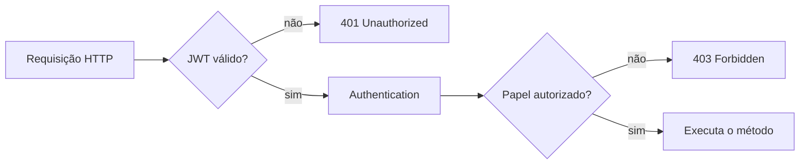

# Aula 14 — Controle de acesso baseado em papéis

## 1. Contexto da aula

Na Aula 13 implementamos autenticação com JWT. A API passou a identificar o
usuário e já restringia operações `DELETE` ao papel `ADMIN`. Essa era uma
primeira regra de acesso, suficiente para demonstrar `401` e `403`, mas ainda
não constituía uma política completa para o sistema.

Nesta aula vamos implementar uma política explícita de autorização baseada em
papéis, conhecida como **RBAC — Role-Based Access Control**.

Ao final:

- usuários `USER` poderão consultar grupos e produtos;
- usuários `ADMIN` poderão consultar e manter grupos e produtos;
- somente `ADMIN` poderá cadastrar, consultar e alterar usuários;
- a senha continuará protegida por BCrypt;
- respostas de usuário nunca apresentarão o hash da senha;
- as regras serão verificadas por testes automatizados.

## 2. Objetivos de aprendizagem

Ao concluir esta aula, o estudante deverá ser capaz de:

- diferenciar autenticação de autorização;
- explicar o modelo RBAC;
- aplicar o princípio do menor privilégio;
- compreender a diferença entre papéis e permissões;
- configurar segurança em nível de requisição e de método;
- utilizar `@EnableMethodSecurity` e `@PreAuthorize`;
- projetar DTOs que não exponham informações sigilosas;
- diferenciar os códigos HTTP `401` e `403` por meio de experimentos;
- testar regras de autorização com `@WithMockUser` e com JWT real.

## 3. Fundamentação teórica

### 3.1 Autenticação não é autorização

O JWT responde principalmente à pergunta **“quem está fazendo a
requisição?”**. Depois de validar assinatura, emissor e expiração, o Spring
Security cria um objeto `Authentication`.

A autorização responde à pergunta **“essa identidade pode executar esta
operação?”**.

```text
Credenciais -> autenticação -> identidade -> autorização -> operação
```

Um usuário pode estar corretamente autenticado e ainda assim não ter acesso a
uma operação. Nesse caso, a resposta adequada é `403 Forbidden`.

### 3.2 RBAC

No RBAC, permissões são agrupadas em papéis. Os usuários recebem papéis em vez
de receber cada permissão individualmente.

```text
Usuario -> Papel -> conjunto de operações permitidas
```

Nosso modelo didático possui dois papéis:

- `USER`: usuário operacional com acesso somente às consultas;
- `ADMIN`: administrador responsável pela manutenção dos dados e dos acessos.

Em um sistema maior poderíamos ter papéis como `TECNICO`, `ATENDENTE` e
`GESTOR`, ou migrar para permissões mais granulares como
`PRODUTO_CRIAR` e `USUARIO_ALTERAR`.

### 3.3 Princípio do menor privilégio

Cada usuário deve receber apenas os privilégios necessários ao seu trabalho.
Conceder `ADMIN` por conveniência aumenta o impacto de erros, credenciais
roubadas e ações indevidas.

A política deve começar restritiva e liberar somente operações justificadas.
Esse raciocínio é conhecido como *default deny*.

### 3.4 Autorizações vertical e horizontal

- **Autorização vertical:** controla funções de níveis diferentes. Exemplo:
  `USER` não pode criar outro usuário administrador.
- **Autorização horizontal:** controla acesso entre objetos do mesmo nível.
  Exemplo futuro: um cliente só pode consultar os chamados pertencentes a ele.

Esta aula implementa autorização vertical. A autorização horizontal depende de
regras de propriedade dos dados e deverá ser planejada quando o domínio passar
a associar registros a usuários.

### 3.5 Segurança em dois níveis

O projeto utiliza duas etapas complementares:

1. `SecurityFilterChain` exige um JWT válido antes de chegar ao controller;
2. `@PreAuthorize` confere o papel antes de executar o método protegido.



Essa separação é importante: autenticação acontece no filtro; autorização pode
acontecer perto da operação de negócio.

## 4. Matriz de acesso da aplicação

| Recurso ou operação | Público | `USER` | `ADMIN` |
|---|:---:|:---:|:---:|
| `POST /api/auth/login` | Sim | Sim | Sim |
| `GET /api/auth/me` | Não | Sim | Sim |
| Consultar grupos | Não | Sim | Sim |
| Consultar produtos | Não | Sim | Sim |
| Criar grupos ou produtos | Não | Não | Sim |
| Alterar grupos ou produtos | Não | Não | Sim |
| Excluir grupos ou produtos | Não | Não | Sim |
| Gerenciar usuários | Não | Não | Sim |

Esta tabela é parte da especificação do sistema. Antes de programar uma regra
de segurança, a equipe deve conseguir expressá-la de forma compreensível.

## 5. Ponto de parada 1 — Habilitar segurança de métodos

Na classe `SecurityConfig`, adicione `@EnableMethodSecurity`:

```java
@Configuration
@EnableMethodSecurity
@EnableConfigurationProperties(JwtProperties.class)
public class SecurityConfig {
    // beans de seguranca
}
```

Mantenha a cadeia HTTP responsável pela autenticação:

```java
.authorizeHttpRequests(authorize -> authorize
        .requestMatchers("/api/auth/login").permitAll()
        .anyRequest().authenticated())
```

Qualquer rota, exceto o login, exige JWT. As decisões específicas por papel
serão feitas com `@PreAuthorize`.

> `hasRole('ADMIN')` procura a authority `ROLE_ADMIN`. Na Aula 13, o claim
> `authorities` do JWT foi convertido exatamente para esse formato.

**Sugestão de commit:**

```bash
git add src/main/java/com/curso/config/SecurityConfig.java
git commit -m "feat: habilita autorizacao em nivel de metodo"
```

## 6. Ponto de parada 2 — Proteger operações de escrita

Nas classes `GrupoProdutoResource` e `ProdutoResource`, anote os métodos de
criação, alteração e exclusão:

```java
@PostMapping
@PreAuthorize("hasRole('ADMIN')")
public ResponseEntity<ProdutoDTO> create(...) {
    // implementacao existente
}

@PutMapping("/{id}")
@PreAuthorize("hasRole('ADMIN')")
public ResponseEntity<ProdutoDTO> update(...) {
    // implementacao existente
}

@DeleteMapping("/{id}")
@PreAuthorize("hasRole('ADMIN')")
public ResponseEntity<Void> delete(...) {
    // implementacao existente
}
```

Os métodos `GET` não recebem `@PreAuthorize`: eles continuam disponíveis para
qualquer usuário autenticado devido à regra `anyRequest().authenticated()`.

### Por que colocar a anotação próxima do método?

A pessoa que lê o endpoint enxerga imediatamente sua exigência. Além disso, a
regra acompanha a operação mesmo se a URL for reorganizada.

Em sistemas maiores, a anotação pode ser colocada na camada de serviço para
proteger a regra de negócio contra chamadas vindas de outros pontos além do
controller.

**Sugestão de commit:**

```bash
git add src/main/java/com/curso/resources/GrupoProdutoResource.java \
        src/main/java/com/curso/resources/ProdutoResource.java
git commit -m "feat: restringe manutencoes ao papel administrador"
```

## 7. Ponto de parada 3 — Contratos seguros para usuários

Não devemos receber ou devolver a entidade `Usuario` diretamente. Ela contém o
hash da senha e representa a persistência, não o contrato público.

Foram criados quatro DTOs com responsabilidades separadas.

### 7.1 Cadastro

```java
public record UsuarioCreateRequest(
        @NotBlank @Size(max = 100) String username,
        @NotBlank @Size(min = 8, max = 72) String password,
        @NotNull Papel papel
) { }
```

### 7.2 Alteração cadastral

```java
public record UsuarioUpdateRequest(
        @NotBlank @Size(max = 100) String username,
        @NotNull Papel papel,
        @NotNull Boolean ativo
) { }
```

A atualização cadastral não recebe senha. Separar as operações reduz o risco
de trocar uma credencial acidentalmente.

### 7.3 Alteração de senha

```java
public record AlterarSenhaRequest(
        @NotBlank
        @Size(min = 8, max = 72)
        String password
) { }
```

### 7.4 Resposta

```java
public record UsuarioResponse(
        Long id,
        String username,
        Papel papel,
        Boolean ativo
) { }
```

Observe que `UsuarioResponse` não possui `senha` nem `password`. Isso impede a
exposição do hash inclusive quando um objeto é serializado por engano.

**Sugestão de commit:**

```bash
git add src/main/java/com/curso/domains/dtos
git commit -m "feat: cria contratos seguros para gerenciamento de usuarios"
```

## 8. Ponto de parada 4 — Serviço de usuários

`UsuarioService` concentra persistência, transformação e codificação de senha.

### 8.1 Criar usuário

```java
@Transactional
public UsuarioResponse create(UsuarioCreateRequest request) {
    validarUsernameDisponivel(request.username(), null);

    Usuario usuario = new Usuario(
            null,
            request.username(),
            passwordEncoder.encode(request.password()),
            request.papel(),
            true
    );
    return toResponse(usuarioRepository.save(usuario));
}
```

O `PasswordEncoder` deve ser usado antes de `save`. Nunca grave
`request.password()` diretamente.

### 8.2 Alterar cadastro

```java
@Transactional
public UsuarioResponse update(Long id, UsuarioUpdateRequest request) {
    Usuario usuario = findEntity(id);
    validarUsernameDisponivel(request.username(), id);

    usuario.setUsername(request.username());
    usuario.setPapel(request.papel());
    usuario.setAtivo(request.ativo());
    return toResponse(usuarioRepository.save(usuario));
}
```

Desativar preserva o registro para auditoria. O `UsuarioDetailsService` converte
`ativo=false` em uma conta desabilitada, impedindo novos logins.

### 8.3 Trocar senha

```java
@Transactional
public void alterarSenha(Long id, AlterarSenhaRequest request) {
    Usuario usuario = findEntity(id);
    usuario.setSenha(passwordEncoder.encode(request.password()));
    usuarioRepository.save(usuario);
}
```

Cada troca produz um novo hash BCrypt. Mesmo reutilizando a mesma senha, o
resultado tende a ser diferente por causa do salt.

## 9. Ponto de parada 5 — API administrativa

Crie `UsuarioResource` e proteja a classe inteira:

```java
@RestController
@RequestMapping("/api/usuarios")
@PreAuthorize("hasRole('ADMIN')")
public class UsuarioResource {
    // endpoints
}
```

Endpoints implementados:

| Método | URL | Finalidade |
|---|---|---|
| `GET` | `/api/usuarios` | Listar usuários |
| `GET` | `/api/usuarios/{id}` | Consultar um usuário |
| `POST` | `/api/usuarios` | Cadastrar usuário |
| `PUT` | `/api/usuarios/{id}` | Alterar username, papel e situação |
| `PUT` | `/api/usuarios/{id}/senha` | Definir nova senha |

Não foi criado `DELETE`. Para identidades, a desativação é preferível porque
mantém o registro e possibilita futura auditoria.

**Sugestão de commit:**

```bash
git add src/main/java/com/curso/services/UsuarioService.java \
        src/main/java/com/curso/resources/UsuarioResource.java
git commit -m "feat: implementa gerenciamento administrativo de usuarios"
```

## 10. Testes com Postman

Use o ambiente e a variável `token` criados na Aula 13.

### 10.1 Criar usuário operacional

Autentique-se como `ADMIN` e envie:

```http
POST {{baseUrl}}/api/usuarios
Authorization: Bearer {{token}}
Content-Type: application/json
```

```json
{
  "username": "aluno",
  "password": "senha-do-aluno",
  "papel": "USER"
}
```

Confira que a resposta não contém senha nem hash.

### 10.2 Verificar acesso de USER

Faça login como `aluno`, salve o novo token e execute:

1. `GET /api/produto`: deve retornar `200`;
2. `POST /api/produto`: deve retornar `403`;
3. `PUT /api/produto/{id}`: deve retornar `403`;
4. `DELETE /api/produto/{id}`: deve retornar `403`;
5. `GET /api/usuarios`: deve retornar `403`.

O token é válido em todos os casos. O que muda é a autorização para a
operação.

### 10.3 Verificar acesso de ADMIN

Faça login novamente como administrador:

1. `GET /api/usuarios`: deve retornar `200`;
2. `POST /api/produto`: deve ser aceito quando o corpo for válido;
3. `PUT /api/usuarios/{id}` com `ativo=false`: deve desativar o usuário;
4. tente fazer novo login com o usuário desativado: deve retornar `401`.

### 10.4 Alterar senha

```http
PUT {{baseUrl}}/api/usuarios/2/senha
Authorization: Bearer {{tokenAdmin}}
Content-Type: application/json
```

```json
{
  "password": "uma-nova-senha"
}
```

A resposta esperada é `204 No Content`. Depois, confirme que a senha antiga
não autentica e a nova senha autentica.

## 11. Testes automatizados

`UsuarioResourceIntegrationTest` verifica:

- criação de usuário por administrador;
- armazenamento do hash BCrypt;
- ausência de senha e hash nas respostas;
- listagem administrativa;
- alteração de papel e situação;
- troca segura de senha;
- resposta `403` quando `USER` acessa a administração.

Exemplo de autorização simulada:

```java
@Test
@WithMockUser(username = "aluno", roles = "USER")
void userNaoDeveGerenciarUsuarios() throws Exception {
    mockMvc.perform(get("/api/usuarios"))
            .andExpect(status().isForbidden());
}
```

`@WithMockUser` é apropriado quando o objetivo do teste é a regra de
autorização. Os testes da Aula 13 continuam responsáveis por verificar emissão
e consumo do JWT real.

Execute:

```bash
./mvnw test
```

Resultado de referência:

```text
Tests run: 79, Failures: 0, Errors: 0, Skipped: 0
BUILD SUCCESS
```

## 12. Discussão de segurança

### 12.1 Alteração do próprio papel

Nesta versão didática, qualquer administrador pode alterar outro administrador
e também seu próprio cadastro. Sistemas reais normalmente criam regras para
impedir que o último administrador seja desativado ou rebaixado.

### 12.2 Tokens já emitidos

Desativar o usuário impede novos logins, mas um JWT emitido anteriormente pode
continuar válido até `exp`. O mesmo vale para uma alteração de papel: o token
antigo ainda carrega as authorities emitidas no login. Revogação imediata
exigiria tokens curtos, lista de revogação, consulta do usuário a cada
requisição ou outra estratégia.

### 12.3 Auditoria

Uma evolução deve registrar quem criou usuários, alterou papéis, desativou
contas e redefiniu senhas. Logs não devem conter senha nem token completo.

### 12.4 Proteção contra abuso

Em produção, o endpoint de login deve receber rate limiting e monitoramento de
tentativas. A API também deve operar exclusivamente em HTTPS.

## 13. Atividade avaliativa

No projeto temático:

1. defina pelo menos dois papéis;
2. produza uma matriz de acesso antes de programar;
3. restrinja operações de escrita a um papel administrativo;
4. implemente gerenciamento de usuários sem expor hashes;
5. crie testes que demonstrem `200`, `401` e `403`;
6. explique uma regra de autorização horizontal aplicável ao seu domínio;
7. justifique onde colocou cada `@PreAuthorize`.

## 14. Checklist

- [ ] `@EnableMethodSecurity` está ativo;
- [ ] o login permanece público;
- [ ] as demais rotas exigem JWT;
- [ ] somente `ADMIN` altera dados de negócio;
- [ ] somente `ADMIN` gerencia usuários;
- [ ] `USER` consegue executar consultas;
- [ ] `UsuarioResponse` não contém senha;
- [ ] toda senha passa pelo `PasswordEncoder`;
- [ ] usuários são desativados em vez de removidos;
- [ ] testes cobrem acessos permitidos e negados.

## 15. Encerramento e tag

Depois da revisão e dos testes:

```bash
git status
git add . ':!graphify-out'
git commit -m "feat: conclui aula 14 de controle de acesso"
git tag -a aula-14-controle-acesso \
  -m "Aula 14 - Controle de acesso baseado em papeis"
git push origin main
git push origin aula-14-controle-acesso
```

## 16. Referências

- [Spring Security — Authorize HTTP Requests](https://docs.spring.io/spring-security/reference/servlet/authorization/authorize-http-requests.html)
- [Spring Security — Method Security](https://docs.spring.io/spring-security/reference/servlet/authorization/method-security.html)
- [Spring Security — Test](https://docs.spring.io/spring-security/reference/servlet/test/index.html)
