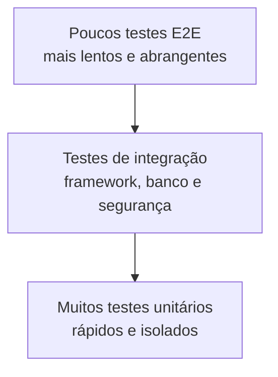
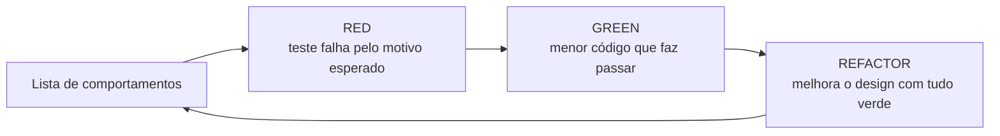

# Aula 15 — Testes de software, TDD e cobertura

## 1. Contexto

Nas aulas anteriores construímos persistência, API REST, autenticação JWT e
controle de acesso. Nesta aula vamos estudar como verificar esses comportamentos
de forma sistemática e como medir quais partes do código foram exercitadas.

O projeto já possui testes unitários e de integração. Portanto, a aula não
começa com uma suíte vazia: começa com uma **auditoria da suíte existente**,
introduz o ciclo TDD e acrescenta o JaCoCo ao processo de build.

Este material foi adaptado do módulo `modulo-3-tdd-e-cobertura.md`. Foram
preservados seus fundamentos — TDD, FIRST, AAA, pirâmide, cobertura de linhas e
ramos e o alerta de que cobertura não garante qualidade — mas os exemplos foram
reescritos para Java, Spring Boot, JUnit 5, Mockito, MockMvc e JaCoCo.

## 2. Objetivos de aprendizagem

Ao final, o estudante deverá ser capaz de:

- explicar por que testamos software;
- diferenciar erro, defeito e falha;
- distinguir testes unitários, de integração e ponta a ponta;
- estruturar testes com Arrange, Act e Assert;
- reconhecer as propriedades FIRST;
- utilizar JUnit 5, AssertJ, Mockito e MockMvc;
- aplicar o ciclo Red → Green → Refactor;
- interpretar cobertura de instruções, linhas, métodos e ramos;
- gerar relatórios JaCoCo no Maven;
- configurar um portão que reprova o build abaixo do limite;
- explicar por que cobertura alta não garante bons testes.

## 3. Por que testar software?

Testes fornecem evidência de que o sistema apresenta o comportamento esperado
nos cenários exercitados. Eles ajudam a:

- detectar regressões;
- documentar regras de forma executável;
- permitir refatorações com menor risco;
- antecipar problemas antes da implantação;
- tornar decisões de qualidade verificáveis pelo build e pelo CI.

Testes não provam que o sistema não possui defeitos. Eles aumentam nossa
confiança dentro do conjunto de comportamentos e riscos analisados.

### 3.1 Erro, defeito e falha

| Termo | Significado | Exemplo |
|---|---|---|
| Erro | Ação humana incorreta | Programador usa `>` em vez de `>=` |
| Defeito | Problema inserido no artefato | Condição incorreta no código |
| Falha | Comportamento incorreto observado | Pedido no limite recebe resultado errado |

Um defeito pode permanecer sem produzir falha enquanto o caminho que o contém
não for executado.

### 3.2 Verificação e validação

- **Verificação:** estamos construindo o produto corretamente de acordo com a
  especificação?
- **Validação:** estamos construindo o produto certo para a necessidade do
  usuário?

Testes unitários apoiam fortemente a verificação. Testes de aceitação e a
avaliação com usuários aproximam o desenvolvimento da validação.

## 4. Níveis de teste



### 4.1 Teste unitário

Verifica uma unidade de comportamento sem inicializar toda a aplicação. Deve
ser rápido e determinístico.

No projeto:

- `ProdutoDomainUnitTest` testa cálculos e invariantes de `Produto`;
- `GrupoProdutoDomainUnitTest` testa a associação bidirecional;
- `ProdutoServiceUnitTest` e `GrupoProdutoServiceUnitTest` usam Mockito para
  substituir repositórios.

### 4.2 Teste de integração

Verifica a colaboração entre partes reais. Os testes `ResourceIntegrationTest`
inicializam o contexto Spring, aplicam o Liquibase no H2, usam os repositórios,
executam os filtros de segurança e chamam a API por `MockMvc`.

`MockMvc` atravessa o processamento Spring MVC, incluindo roteamento,
serialização, validação e tratamento de exceções, sem abrir um servidor HTTP.

### 4.3 Teste ponta a ponta

Executa o sistema completo pela interface externa, normalmente com aplicação e
banco em processos reais. Oferece alta confiança, mas é mais lento e mais caro
de manter. O roteiro Postman das aulas anteriores é manual; uma evolução poderá
automatizá-lo com Newman, REST Assured ou testes em containers.

## 5. Anatomia de um bom teste

### 5.1 Arrange, Act, Assert

```java
@Test
@DisplayName("Deve calcular o valor do estoque")
void deveCalcularValorEstoque() {
    // Arrange: cenário e valores conhecidos
    GrupoProduto grupo =
            new GrupoProduto(1, "Informatica", Status.ATIVO);

    // Act: comportamento público observado
    Produto produto = new Produto(
            null,
            "7890000000001",
            "Cabo de rede",
            new BigDecimal("4.000"),
            new BigDecimal("12.50"),
            LocalDate.now(),
            grupo,
            Status.ATIVO
    );

    // Assert: resultado conhecido, calculado independentemente
    assertThat(produto.getValorEstoque()).isEqualByComparingTo("50.00");
}
```

No código real, o cálculo é acionado pelo ciclo de persistência e já possui
testes apropriados. O ponto do exemplo é separar preparação, execução e
verificação.

### 5.2 FIRST

| Letra | Propriedade | Aplicação prática |
|---|---|---|
| F | Fast | Unitários devem executar em milissegundos |
| I | Independent | Um teste não depende da ordem de outro |
| R | Repeatable | Mesmo resultado em qualquer máquina |
| S | Self-validating | O resultado é aprovado ou reprovado automaticamente |
| T | Timely | O teste é escrito no momento adequado, idealmente antes |

### 5.3 Nomear pelo comportamento

Prefira:

```java
void deveRecusarLoginDeUsuarioDesativado()
```

Evite:

```java
void deveChamarFindByUsernameUmaVez()
```

O primeiro descreve uma regra observável. O segundo congela um detalhe de
implementação.

### 5.4 Uma unidade lógica por teste

Um teste pode conter várias asserções quando todas verificam o mesmo
comportamento, como status HTTP, corpo e cabeçalho de uma criação. Se o nome do
teste precisar unir comportamentos independentes com “e”, considere separá-lo.

## 6. Ferramentas utilizadas

| Ferramenta | Responsabilidade |
|---|---|
| JUnit 5 | Descoberta, ciclo de vida e execução dos testes |
| AssertJ | Asserções fluentes sobre objetos Java |
| Mockito | Dublês para dependências controladas |
| MockMvc | Requisições MVC sem servidor HTTP real |
| Spring Security Test | Usuários simulados e apoio à segurança |
| H2 | Banco rápido no perfil de teste |
| Liquibase | Criação da mesma estrutura versionada nos testes |
| JaCoCo | Instrumentação e medição de cobertura |

Todas, exceto o JaCoCo, já chegaram transitivamente ou explicitamente com as
dependências de teste das aulas anteriores.

## 7. Auditoria da suíte atual

Antes da configuração do portão, a suíte apresenta:

| Grupo | Quantidade | Tipo predominante |
|---|---:|---|
| Domínio (`Produto` e `GrupoProduto`) | 16 | Unitário |
| Serviços de produto e grupo | 28 | Unitário com Mockito |
| Resources de produto e grupo | 20 | Integração |
| Autenticação e autorização | 8 | Integração |
| Administração de usuários | 5 | Integração |
| Inicialização do contexto | 1 | Smoke test |
| Teste externo ao domínio `com.curso` | 1 | Unitário isolado |
| **Total** | **79** | — |

O arquivo `LocalUserDetailsServiceTest`, no pacote `com.erp.qualitascareapi`,
não exercita classes de produção do `suporteos2025`. Ele aumenta a contagem de
testes, mas não a cobertura do sistema. Isso demonstra por que contar testes é
uma métrica insuficiente. O arquivo deve ser revisado em uma futura atividade
de organização, não apagado automaticamente.

## 8. TDD — Test-Driven Development

TDD é uma disciplina de especificação e design incremental. O teste é escrito
antes do código de produção, em ciclos curtos.



### 8.1 RED

Escolha um comportamento, escreva o teste e execute-o. A falha prova que o teste
é capaz de detectar a ausência ou incorreção do comportamento. Um teste nunca
visto falhar pode estar exercitando o lugar errado.

### 8.2 GREEN

Implemente apenas o necessário para o teste passar. Não antecipe funcionalidades
futuras. Execute toda a suíte para detectar regressões.

### 8.3 REFACTOR

Com a suíte verde, melhore nomes, elimine duplicação e simplifique o desenho sem
alterar o comportamento externo. Testes também são código e devem ser
refatorados.

### 8.4 TDD não significa escrever todos os testes antes

O ciclo correto é vertical:

```text
teste 1 -> implementação 1 -> teste 2 -> implementação 2 -> ...
```

Escrever dezenas de testes imaginados e só depois toda a implementação cria
acoplamento prematuro e demora a produzir feedback.

## 9. Exemplo guiado de TDD no projeto

Comportamento: **não permitir dois usuários com o mesmo username**.

Lista inicial:

```text
[ ] username novo pode ser cadastrado
[ ] username já existente é recusado
[ ] atualização pode manter o próprio username
[ ] atualização não pode usar username de outro usuário
```

### 9.1 Primeiro ciclo — cadastro válido

Teste unitário conceitual para `UsuarioService`:

```java
@Test
void deveCadastrarUsernameDisponivel() {
    // Arrange
    UsuarioCreateRequest request =
            new UsuarioCreateRequest("ana", "senha-segura", Papel.USER);
    when(usuarioRepository.findByUsername("ana")).thenReturn(Optional.empty());
    when(passwordEncoder.encode("senha-segura")).thenReturn("hash-bcrypt");
    when(usuarioRepository.save(any(Usuario.class)))
            .thenAnswer(invocation -> invocation.getArgument(0));

    // Act
    UsuarioResponse response = usuarioService.create(request);

    // Assert
    assertThat(response.username()).isEqualTo("ana");
}
```

### 9.2 Segundo ciclo — duplicidade

Escreva e execute antes da implementação:

```java
@Test
void deveRecusarUsernameDuplicado() {
    Usuario existente =
            new Usuario(1L, "ana", "hash", Papel.USER, true);
    when(usuarioRepository.findByUsername("ana"))
            .thenReturn(Optional.of(existente));

    UsuarioCreateRequest request =
            new UsuarioCreateRequest("ana", "outra-senha", Papel.USER);

    assertThatThrownBy(() -> usuarioService.create(request))
            .isInstanceOf(DataIntegrityViolationException.class)
            .hasMessageContaining("username");
}
```

Observe o esperado literal: o teste não reimplementa a lógica do método. O
teste descreve um comportamento público do serviço.

### 9.3 Quando usar Mockito

Neste teste, repositório e encoder representam colaboradores substituídos para
isolar a regra do serviço. Não faça mock de DTOs ou da própria classe testada.
Nos testes de integração, prefira repositórios, filtros e serialização reais.

## 10. Cobertura de código

Cobertura mede quanto código foi **executado**, não quanto foi corretamente
**verificado**.

| Métrica | O que mede |
|---|---|
| Instruções | Instruções de bytecode executadas |
| Linhas | Linhas com instruções executadas |
| Métodos | Métodos chamados ao menos uma vez |
| Classes | Classes tocadas pela suíte |
| Ramos | Saídas possíveis de decisões como `if` e `switch` |

### 10.1 Por que ramos importam

Considere:

```java
if (usuario.getAtivo()) {
    permitirLogin();
} else {
    recusarLogin();
}
```

Um teste do usuário ativo pode executar a linha do `if`, mas não verifica o
caminho do usuário inativo. Cobertura de ramos exige exercitar as duas saídas.

### 10.2 Cobertura não é qualidade

Este teste aumenta cobertura, mas não verifica nada:

```java
@Test
void testeSemValor() {
    usuarioService.findAll();
}
```

Uma suíte pode chegar a 100% chamando todos os métodos sem asserções relevantes.
Por isso, cobertura é uma ferramenta de diagnóstico e um piso de qualidade, não
uma prova de correção.

## 11. Ponto de parada 1 — Configurar JaCoCo

Foram adicionadas propriedades explícitas ao `pom.xml`:

```xml
<jacoco.version>0.8.15</jacoco.version>
<jacoco.minimum.line.coverage>0.80</jacoco.minimum.line.coverage>
<jacoco.minimum.branch.coverage>0.55</jacoco.minimum.branch.coverage>
```

E o plugin:

```xml
<plugin>
    <groupId>org.jacoco</groupId>
    <artifactId>jacoco-maven-plugin</artifactId>
    <version>${jacoco.version}</version>
    <executions>
        <execution>
            <id>prepare-agent</id>
            <goals>
                <goal>prepare-agent</goal>
            </goals>
        </execution>
        <execution>
            <id>generate-report</id>
            <phase>verify</phase>
            <goals>
                <goal>report</goal>
            </goals>
        </execution>
        <execution>
            <id>check-coverage</id>
            <phase>verify</phase>
            <goals>
                <goal>check</goal>
            </goals>
            <configuration>
                <rules>
                    <rule>
                        <element>BUNDLE</element>
                        <limits>
                            <limit>
                                <counter>LINE</counter>
                                <value>COVEREDRATIO</value>
                                <minimum>${jacoco.minimum.line.coverage}</minimum>
                            </limit>
                            <limit>
                                <counter>BRANCH</counter>
                                <value>COVEREDRATIO</value>
                                <minimum>${jacoco.minimum.branch.coverage}</minimum>
                            </limit>
                        </limits>
                    </rule>
                </rules>
            </configuration>
        </execution>
    </executions>
</plugin>
```

Responsabilidades:

- `prepare-agent`: instrumenta as classes enquanto os testes executam;
- `report`: transforma os dados em relatórios HTML, XML e CSV;
- `check`: compara o resultado com os mínimos e falha o build se necessário.

**Sugestão de commit:**

```bash
git add pom.xml
git commit -m "build: configura cobertura de testes com JaCoCo"
```

## 12. Ponto de parada 2 — Gerar o relatório

Execute:

```bash
./mvnw clean verify
```

O ciclo `verify` inclui compilação, testes, relatório e verificação do portão.
Executar apenas `./mvnw test` roda os testes, mas não chega à fase em que o
relatório e o `check` foram associados.

Relatórios gerados:

```text
target/site/jacoco/index.html
target/site/jacoco/jacoco.xml
target/site/jacoco/jacoco.csv
```

No macOS:

```bash
open target/site/jacoco/index.html
```

No IntelliJ, também é possível abrir `index.html` diretamente pelo painel do
projeto. O relatório permite navegar por pacote, classe e linha.

## 13. Linha de base medida no projeto

Com os 79 testes atuais, a medição real foi:

| Métrica | Coberto | Total | Percentual |
|---|---:|---:|---:|
| Instruções | 2.156 | 2.586 | 83,37% |
| Linhas | 572 | 668 | 85,63% |
| Ramos | 94 | 162 | 58,02% |
| Métodos | 187 | 220 | 85,00% |

### 13.1 Interpretação

A cobertura de linhas já supera 80%, mas a cobertura de ramos revela caminhos
não exercitados. As maiores oportunidades estão em:

- caminhos alternativos dos mappers;
- validações de `JwtProperties`;
- inicialização do administrador;
- duplicidade e atualização em `UsuarioService`;
- exceções e condições de fronteira nos serviços.

### 13.2 Por que o portão inicial de ramos é 55%?

O valor representa a realidade encontrada, arredondada para baixo. Sua função é
impedir regressão imediata: código novo não pode fazer o projeto cair abaixo do
piso atual.

O objetivo acadêmico continua sendo **80% de linhas e 80% de ramos**. A turma
deverá elevar o limite gradualmente à medida que acrescenta testes de
comportamento. Não é permitido atingir a meta por meio de:

- redução do limite;
- exclusões arbitrárias;
- remoção ou desativação de testes;
- testes sem asserções;
- chamadas artificiais apenas para “pintar” linhas de verde.

Uma progressão possível:

```text
55% -> 60% -> 70% -> 80% de ramos
```

Cada aumento deve ser acompanhado por testes que expliquem quais comportamentos
passaram a ser protegidos.

## 14. Ponto de parada 3 — Demonstrar o portão

Para observar uma reprovação sem alterar permanentemente o projeto:

```bash
./mvnw verify -Djacoco.minimum.branch.coverage=0.80
```

Os 79 testes passam, mas o build deve falhar porque a cobertura de ramos ainda
está abaixo de 80%. Essa diferença é essencial:

```text
testes aprovados != política de qualidade aprovada
```

Depois execute novamente com a configuração versionada:

```bash
./mvnw verify
```

O build deve voltar a passar.

## 15. Como ler o relatório HTML

O JaCoCo usa cores:

- verde: trecho coberto;
- vermelho: trecho não coberto;
- amarelo: decisão parcialmente coberta.

Ao abrir uma classe, procure primeiro linhas amarelas. Elas normalmente indicam
que apenas um lado de um `if`, operador booleano ou `switch` foi exercitado.

Perguntas para cada lacuna:

1. Existe um comportamento relevante nesse caminho?
2. Qual interface pública permite observá-lo?
3. Qual cenário faria o teste falhar antes da implementação?
4. O resultado esperado vem da regra ou foi copiado do código?
5. O teste continuará válido após uma refatoração interna?

## 16. Estratégia de evolução da cobertura

Não escolha testes apenas pela linha vermelha. Priorize risco:

1. autenticação e autorização;
2. regras que alteram dados;
3. cálculos financeiros e estoque;
4. validações e valores de fronteira;
5. mapeamento entre entidade e DTO;
6. tratamento de exceções;
7. código trivial de configuração e getters.

### 16.1 Atividade guiada

Escolha `UsuarioService` e escreva, em ciclos TDD:

- criação com username disponível;
- rejeição de username duplicado;
- atualização mantendo o próprio username;
- rejeição ao usar username de outro usuário;
- consulta de ID inexistente;
- troca de senha gerando um hash diferente do texto recebido.

Após cada ciclo:

```bash
./mvnw test -Dtest=UsuarioServiceUnitTest
./mvnw verify
```

Registre a variação da cobertura de ramos. O percentual é consequência; a
entrega principal são comportamentos relevantes protegidos.

## 17. Dublês de teste e seus limites

| Dublê | Função |
|---|---|
| Dummy | Preenche um parâmetro que não será usado |
| Stub | Retorna respostas programadas |
| Spy | Registra chamadas recebidas |
| Mock | Verifica expectativas de interação |
| Fake | Implementação simplificada, como repositório em memória |

Use Mockito quando isolar uma fronteira torna o teste menor e mais claro. Evite
mockar todas as classes internas: isso produz testes que conhecem a
implementação e quebram durante refatorações legítimas.

No projeto, há dois usos complementares:

- serviços unitários usam repositórios simulados para testar regras rapidamente;
- resources usam banco H2, Liquibase, segurança e MVC reais para verificar a
  integração.

## 18. Testes parametrizados e valores de fronteira

JUnit 5 permite executar a mesma regra com diferentes entradas:

```java
@ParameterizedTest
@CsvSource({
        "0, INATIVO",
        "1, ATIVO"
})
void deveConverterCodigoParaStatus(Integer codigo, Status esperado) {
    assertThat(Status.toEnum(codigo)).isEqualTo(esperado);
}
```

Valores de fronteira merecem atenção especial. Para um limite de tamanho entre
8 e 72 caracteres, teste pelo menos:

```text
7, 8, 72 e 73 caracteres
```

Esses casos exercitam os dois lados das decisões e são mais valiosos que muitos
valores aleatórios no meio do intervalo.

## 19. Cobertura e teste de mutação

O teste de mutação altera propositalmente o código e verifica se a suíte detecta
a mudança. Exemplos de mutantes:

- `>=` trocado por `>`;
- `true` trocado por `false`;
- multiplicação trocada por divisão;
- condição removida.

Se nenhum teste falhar, o mutante sobreviveu e existe uma lacuna de verificação.
Para Java, uma ferramenta conhecida é o PIT. A execução de mutação é mais cara;
ela pode ser introduzida posteriormente em módulos críticos ou em uma rotina
noturna de CI.

## 20. Integração contínua

Em uma evolução do repositório, um workflow pode executar:

```yaml
name: testes

on:
  push:
  pull_request:

jobs:
  verificar:
    runs-on: ubuntu-latest
    steps:
      - uses: actions/checkout@v4
      - uses: actions/setup-java@v4
        with:
          distribution: temurin
          java-version: 17
          cache: maven
      - run: ./mvnw --batch-mode clean verify
      - uses: actions/upload-artifact@v4
        if: always()
        with:
          name: relatorio-jacoco
          path: target/site/jacoco/
```

O CI deve executar o mesmo comando usado localmente. Dessa forma, a política de
qualidade é reproduzível para toda a turma.

## 21. Atividade avaliativa

Cada estudante deverá:

1. apresentar o relatório JaCoCo inicial;
2. escolher uma classe com ramos parcialmente cobertos;
3. escrever uma lista de comportamentos e valores de fronteira;
4. executar pelo menos três ciclos Red → Green → Refactor;
5. anexar evidência de pelo menos um teste falhando antes da implementação;
6. aumentar a cobertura de ramos sem reduzir limites ou criar exclusões;
7. justificar o uso de cada mock;
8. demonstrar um teste que detecta uma alteração proposital no código;
9. atualizar o limite de ramos somente depois de a nova suíte suportá-lo.

Critérios sugeridos:

| Critério | Peso |
|---|---:|
| Qualidade e relevância dos cenários | 30% |
| Evidência do ciclo TDD | 20% |
| Asserções e valores de fronteira | 20% |
| Evolução de cobertura de ramos | 15% |
| Clareza e organização dos testes | 10% |
| Justificativa dos dublês | 5% |

## 22. Checklist

- [ ] Todos os testes estão verdes;
- [ ] `./mvnw clean verify` termina com `BUILD SUCCESS`;
- [ ] o relatório HTML foi aberto e interpretado;
- [ ] cobertura de linhas permanece em pelo menos 80%;
- [ ] cobertura de ramos não fica abaixo do portão versionado;
- [ ] testes possuem asserções relevantes;
- [ ] caminhos de sucesso e erro foram considerados;
- [ ] mocks representam dependências, não a classe testada;
- [ ] nenhum limite foi reduzido para fazer o build passar;
- [ ] nenhuma exclusão foi adicionada sem justificativa.

## 23. Encerramento e tag

Depois de revisar o relatório e executar o build:

```bash
git status
git add pom.xml README.md docs/aulas/AULA-15-TESTES-E-COBERTURA.md
git commit -m "docs: conclui aula 15 de testes e cobertura"
git tag -a aula-15-testes-cobertura \
  -m "Aula 15 - Testes de software, TDD e cobertura"
git push origin main
git push origin aula-15-testes-cobertura
```

## 24. Referências

- Kent Beck. *Test-Driven Development: By Example*. Addison-Wesley, 2002.
- Gerard Meszaros. *xUnit Test Patterns*. Addison-Wesley, 2007.
- Michael Feathers. *Working Effectively with Legacy Code*. Prentice Hall, 2004.
- [JUnit 5 User Guide](https://junit.org/junit5/docs/current/user-guide/)
- [Spring Framework — MockMvc](https://docs.spring.io/spring-framework/reference/testing/mockmvc.html)
- [JaCoCo Maven Plugin](https://www.jacoco.org/jacoco/trunk/doc/maven.html)
- [JaCoCo Check Goal](https://www.jacoco.org/jacoco/trunk/doc/check-mojo.html)
- [Google Testing Blog — Code Coverage Best Practices](https://testing.googleblog.com/2020/08/code-coverage-best-practices.html)
